# ADB Remote

Control any Android TV, Android box or Android device from your iPhone or Android phone, over
Wi-Fi. ADB Remote speaks ADB (Android Debug Bridge) directly from the phone. There's no
computer, no server and no account.

- **Remote**: a d-pad, media keys, a trackpad and live typing (any language).
- **See and touch the TV screen** on your phone.
- **Play**: send photos and videos from your phone, YouTube videos and links. You can also
  **mirror your whole screen with sound**, from an iPhone (built-in AirPlay receiver) or an
  Android phone.
- **Apps**: browse, open, stop, uninstall, back up and install apps (`.apk`, `.apks`, `.xapk`, `.apkm`).
- **Files**: browse the TV's storage, upload and download files.

| iPhone | | | | |
| --- | --- | --- | --- | --- |
| 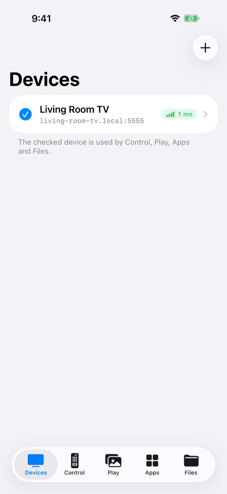 | 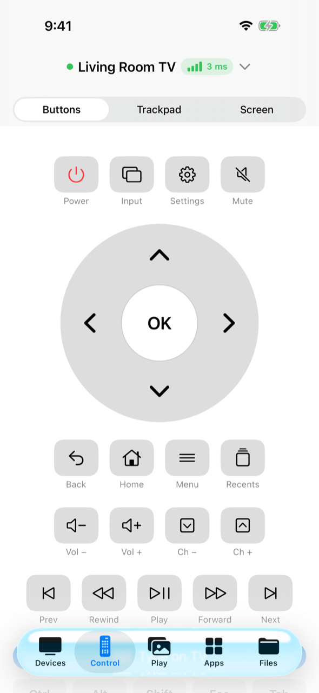 | 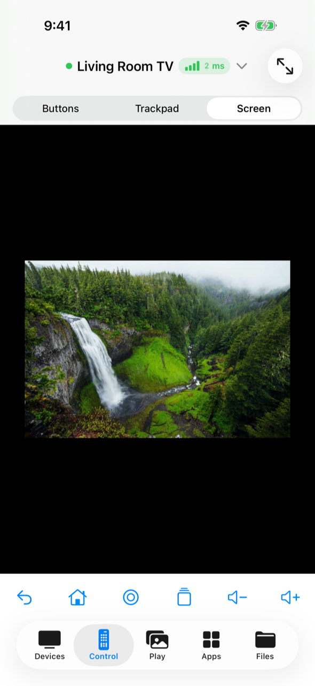 | 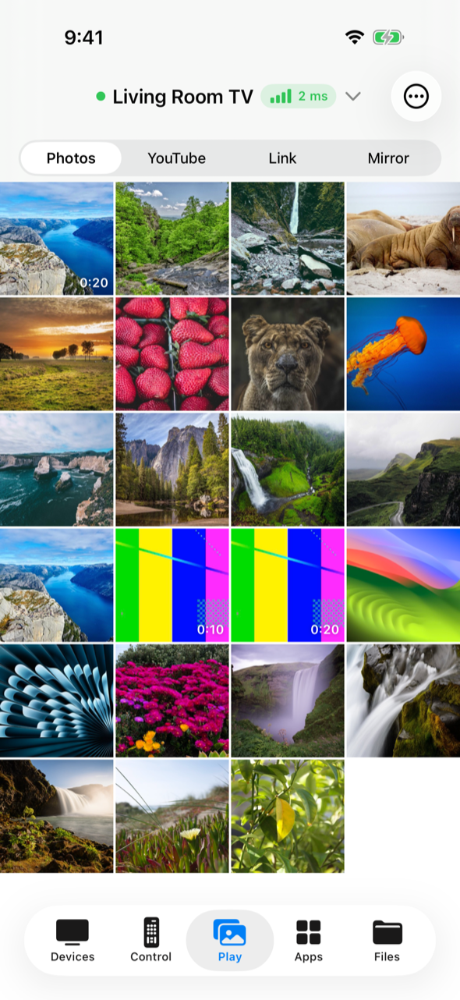 | 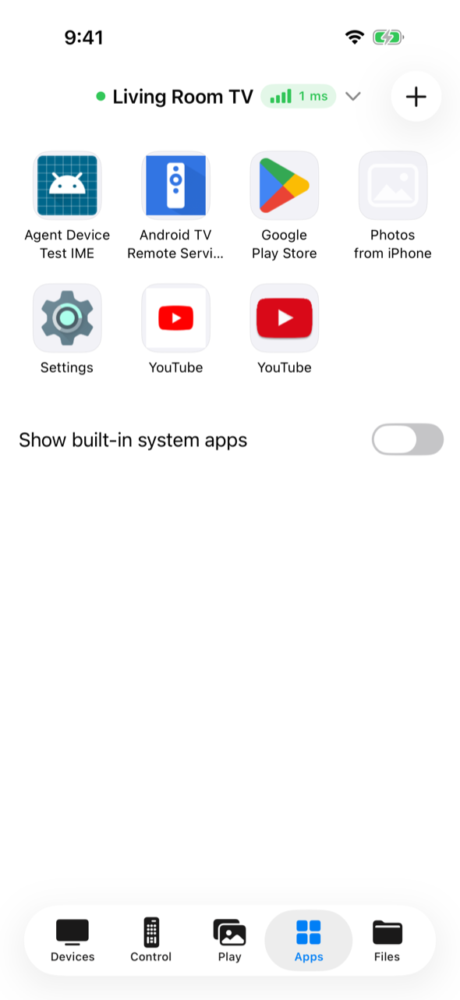 |

| Android | | | | |
| --- | --- | --- | --- | --- |
| 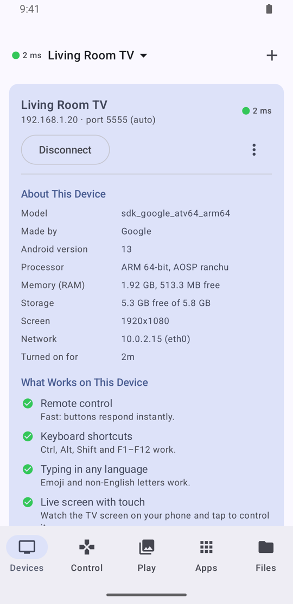 | 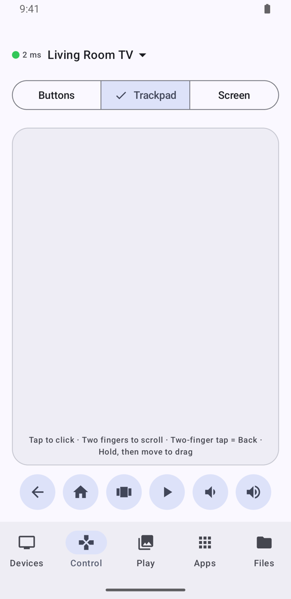 | 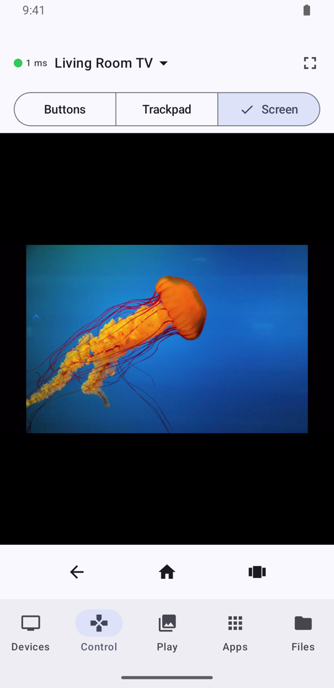 | 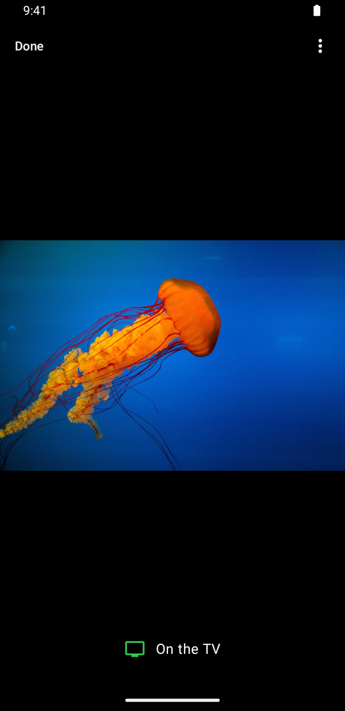 | 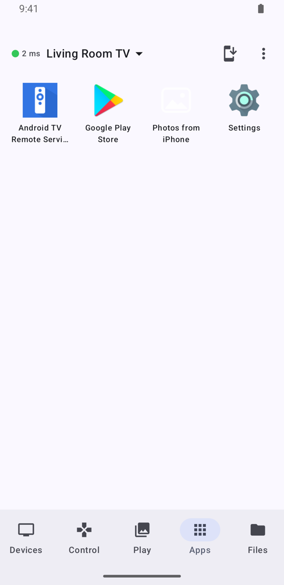 |

| On the TV |
| --- |
|  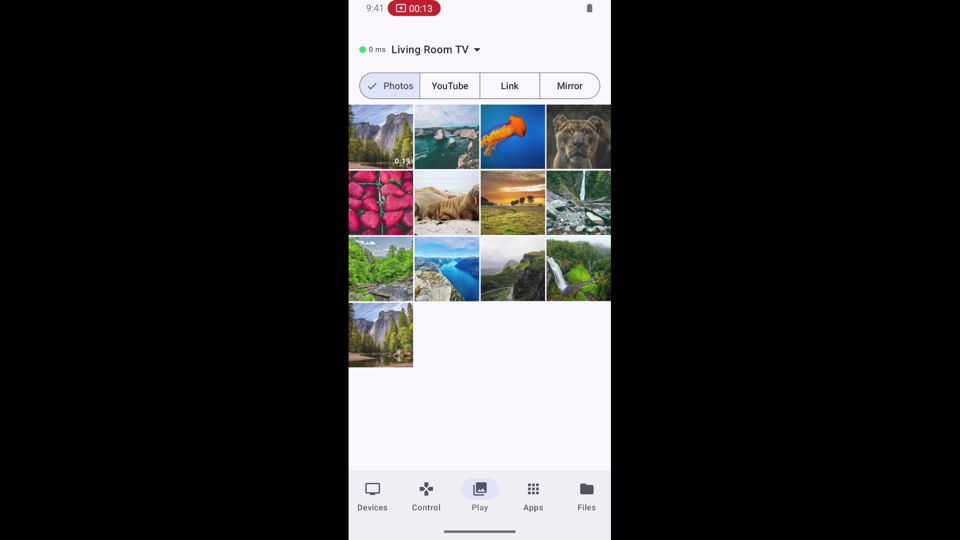 |

More screenshots are in the [User guide](docs/USER_GUIDE.md).

## Features

### Devices
- Add a TV by its IP address. The ADB port is found automatically: the last port that
  worked, then 5555, then a port scan if you ask for one.
- Works with classic network debugging (`adb tcpip`) and with Android 11+ **Wireless
  debugging**, including **pairing with a 6-digit code**.
- Shows what the device is (model, Android version, memory, storage, screen), whether it
  is rooted, whether it has Google Play, and which of this app's features work on it.
- Includes a transfer speed test and a per-device connection log that you can share.
- The app reconnects on its own. A connection that stops answering for 10 seconds is
  replaced.

### Control
- **Buttons**: d-pad, OK (long-press works), Back, Home, Menu, Recents, volume, channels,
  media keys, power, input, settings, Esc/Tab/Enter/function keys.
- **Live typing**: what you type appears on the TV as you type, in any language. You can
  also send a whole piece of text (for example a password) in one go.
- **Trackpad**:
  - Gestures: tap to click, two fingers to scroll, two-finger tap for Back, hold then move
    to drag.
  - Uses a virtual mouse where Android allows it. Otherwise the TV app draws a pointer.
- **Screen**: the TV's screen live on your phone (H.264 through scrcpy). Tap and swipe on it
  to control the TV. It can go full screen.

### Play
- **Photos & videos** from your phone's library. Swipe through them on the phone and the TV
  follows.
  - Photos crossfade, and zooming on the phone zooms on the TV too.
  - Videos stream from the phone, with play/pause, ±10 s and a scrubber. On iPhone, HEVC
    videos are converted for TVs that can't play HEVC.
- **YouTube**: browse YouTube on the phone and tap **Play on TV**. Links go to the TV's
  YouTube app (YouTube, SmartTube or TizenTube).
- **Links**: paste or share any link (**Send to TV** in the share sheet on both platforms).
  YouTube links open in the TV's YouTube app, other links in its browser.
- **Mirror**:
  - **iPhone**: the TV becomes an **AirPlay receiver**. It mirrors the iPhone screen with
    sound, plays Music over AirPlay, and plays YouTube or Photos videos handed over with
    AirPlay. Colours are converted correctly on TVs that crush greys.
  - **Android phone**: the phone's screen and sound go to the TV (H.264 + PCM), and the
    picture turns when you rotate the phone.

### Apps
- Every app with its icon. Tap one to open it on the TV; long-press for more.
- Force stop, uninstall (including built-in apps, for the current user), and save an app's
  APK (split apps as `.apks`).
- Install `.apk`, `.apks`, `.xapk` and `.apkm` files from your phone.

### Files
- Browse internal storage, USB drives and SD cards, or the whole file system.
- Upload from the phone, save to the phone, rename, delete, create folders, and open a
  media file on the TV.

### Works with old TVs
- Android 4.4 and newer are supported. On Android 4.x, a small helper replaces the slow
  `input keyevent` so the remote stays instant.
- Features that need a newer Android are marked in the device details.

## How it works

```
iPhone app (SwiftUI) ─┐
                      ├─► AdbKit (Swift: ADB, TLS pairing, scrcpy, casting…) ─► TV's adbd over Wi-Fi
Android app (Compose) ┘        (Android: through JNI)                            ├─ scrcpy-server
                                                                                 ├─ helper jar
                                                                                 └─ TV app (viewer, AirPlay)
```

Both phone apps share one engine, **AdbKit**, written in Swift. The Android app runs it
through the Swift SDK for Android and a small JNI bridge. Anything the TV needs is pushed
and started over ADB the first time a feature uses it. See
[Architecture](docs/ARCHITECTURE.md) and [Protocols](docs/PROTOCOLS.md).

## Getting started

1. **Turn on debugging on the TV.**
   - Android TV / Google TV: Settings → Device Preferences → About → press **Build** 7
     times. Then Settings → Device Preferences → Developer options → turn on **USB
     debugging** and **Network debugging** (or **Wireless debugging** on Android 11+).
   - Some boxes have network ADB on port 5555 already, or a different port such as 5789.
     The app can scan for it.
   - BlueStacks: Settings → Advanced → Android Debug Bridge.
2. **Add the TV** in the app with its IP address (Settings → Network on the TV shows it).
3. **Allow** the connection on the TV the first time ("Always allow from this computer").
   With Wireless debugging, use **Pair with Code** instead.

Your phone and the TV must be on the same network. For help with each tab, see the
[User guide](docs/USER_GUIDE.md).

## Building

| Part | Needs | Command |
| --- | --- | --- |
| iOS app | Xcode 26, [XcodeGen](https://github.com/yonaskolb/XcodeGen) | `cd App && xcodegen && open AdbRemote.xcodeproj`, or `Tools/build-ipa.sh` |
| Android app | Android SDK + NDK r30, Swift 6.4.1 + Swift SDK for Android | `cd AndroidRemote && ./gradlew assembleDebug`, or `Tools/build-apk.sh` |
| TV app | Android SDK, NDK | `AndroidViewer/build.sh` |
| Helper jar | Android SDK | `AndroidHelper/build.sh` |

Built copies of the TV app, helper jar and scrcpy-server are kept in `App/Resources/`, so
the phone apps build without rebuilding them. Step-by-step instructions are in
[Building](docs/BUILDING.md).

## Security and privacy

- ADB gives **full control** of the device. Use it on networks you trust, and turn network
  debugging off when you don't need it.
- The phone keeps its own ADB key (RSA 2048) on the phone. The TV remembers it when you
  tap "Always allow".
- Everything stays on your local network. There's no analytics, account or cloud.
- Photos, videos and Android mirroring travel unencrypted on your local network, like most
  casting protocols. AirPlay mirroring is encrypted as the iPhone requires.

## Documentation

- [User guide](docs/USER_GUIDE.md): every screen, with screenshots
- [Architecture](docs/ARCHITECTURE.md): how the parts fit together
- [Protocols](docs/PROTOCOLS.md): the TV app's ports and message formats, and the Android bridge
- [Building](docs/BUILDING.md): toolchains, scripts, tests and screenshots

## Disclaimer

ADB Remote is not affiliated with Google, Apple or any TV maker. "Android", "Android TV",
"Google TV" and "YouTube" are trademarks of Google LLC; "AirPlay", "iPhone" and "iOS" are
trademarks of Apple Inc. The AirPlay receiver is an independent, interoperable
implementation based on the open-source [UxPlay](https://github.com/FDH2/UxPlay) project.
Use ADB Remote only with devices you own or are allowed to manage.

## License

ADB Remote is released under the [GNU General Public License v3.0](LICENSE). The TV app
includes GPL-3.0 code (the FairPlay part of the AirPlay receiver), and other parts use
Apache-2.0, MIT and public-domain code. See [THIRD_PARTY_NOTICES.md](THIRD_PARTY_NOTICES.md).
