# User guide

The iPhone and Android apps have the same five tabs: **Devices, Control, Play, Apps,
Files**. The device at the top of the Control, Play, Apps and Files tabs is the one they
act on. Tap its name to switch.

## Before you start: turn on debugging on the TV

- **Android TV / Google TV**:
  1. Settings → Device Preferences → About → press **Build** seven times to unlock
     Developer options.
  2. Settings → Device Preferences → Developer options → turn on **USB debugging**.
  3. Also turn on either:
     - **Network debugging** (also called "ADB over network"), or
     - **Wireless debugging** on Android 11+.
- **Boxes and TVs from operators** often have network ADB on already, sometimes on an
  unusual port. Leave the port blank in the app and it will look for it.
- **Android phones and tablets**: Developer options → Wireless debugging.
- **BlueStacks**: Settings → Advanced → Android Debug Bridge.

The phone and the TV must be on the same Wi-Fi or network.

## Devices

| iPhone | Android |
| --- | --- |
|  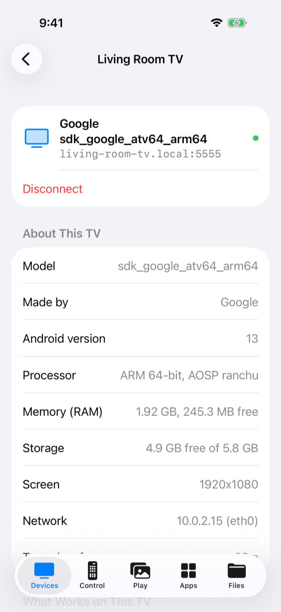 |  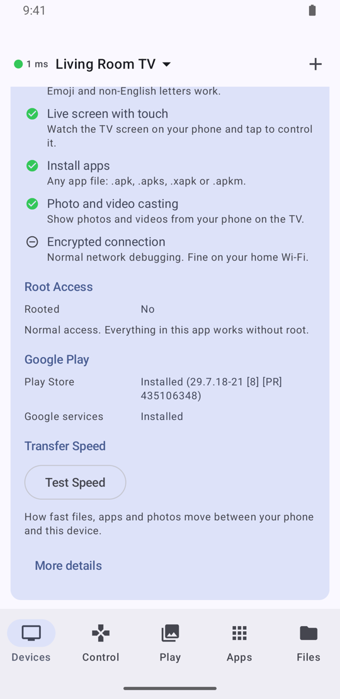 |

- **Add a device**: tap **+** and enter its IP address. A name and port are optional.
  - Without a port, the app tries the last port that worked, then 5555.
  - If neither answers, it offers to **scan** the device for its ADB port.
- **First connection**: the TV asks to allow this phone. Tick **Always allow** and press **OK**.
- **Wireless debugging (Android 11+)**: choose **Pair with Code**.
  1. On the TV, open Wireless debugging → **Pair device with pairing code**.
  2. Enter the pairing port and the six-digit code in the app.
- **Details**:
  - The model, Android version, memory, storage, screen and network.
  - **What works on this device**, **Root access** and **Google Play**.
  - A **speed test**. Under **More details** you'll find the technical information.
- **Connection log**: pings, key presses and reconnects, with times. Share it when
  something feels slow.
- **Status dot**:
  - Green with a time: connected, and how long the TV takes to answer.
  - Orange "No reply": the TV isn't answering. After 10 seconds the app reconnects.
  - Grey: not connected.

## Control

### Buttons

| iPhone | Android |
| --- | --- |
|  | 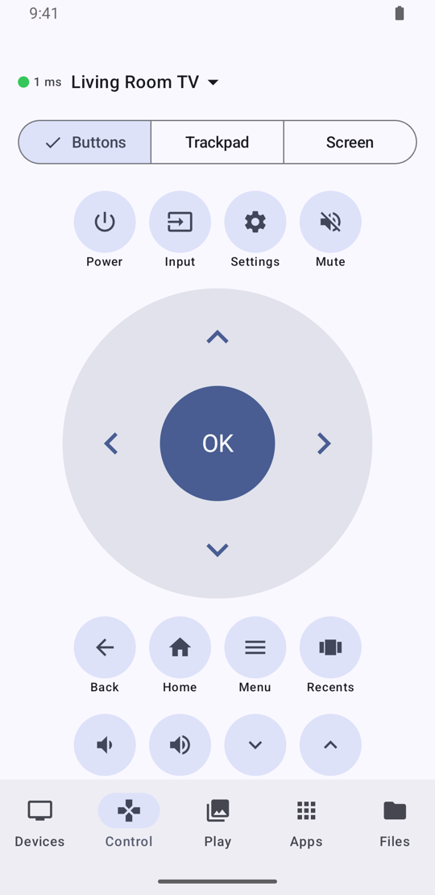 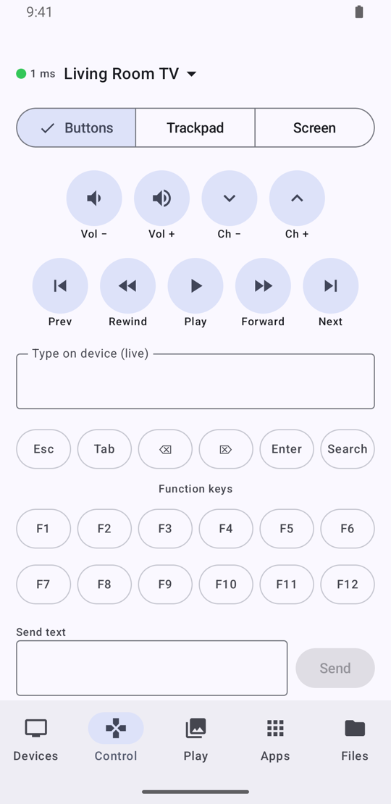 |

- **The d-pad**:
  - The arrows move around.
  - **OK** selects. Hold it for a long press, for example to open an app's options on the
    TV.
- **Other keys**:
  - Back, Home, Menu, Recents.
  - Volume, Mute, Channel ±, Power, Input, Settings.
  - Media keys.
- **Type on TV**: letters appear on the TV as you type, in any language or with emoji.
  - Delete removes characters on the TV.
  - On iPhone, a hardware keyboard works too, including Ctrl/Alt/Shift shortcuts.
- **Keys**: Esc, Tab, Delete, Forward Delete, Enter, Search and F1–F12.
- **Send text**: sends a whole piece of text at once, for example a password.

Keys go through scrcpy's control channel (instant) on Android 5+. On Android 4.x they go
through the app's own helper.

### Trackpad

| iPhone | Android |
| --- | --- |
| 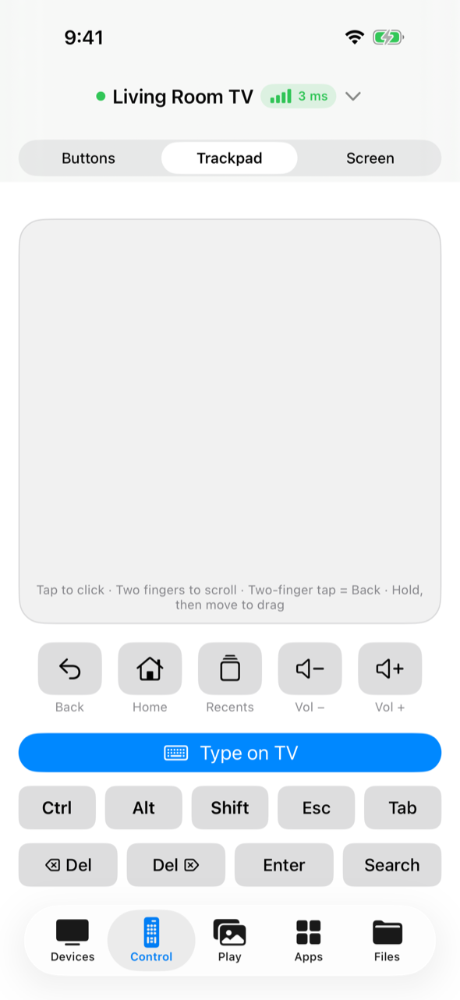 |  |

- **One finger**: moves the pointer. Faster swipes go further.
- **Tap**: clicks.
- **Two-finger tap**: Back.
- **Two fingers**: scroll.
- **Hold, then move**: drag.

If the device allows a virtual mouse, Android draws its own pointer. Otherwise the TV app
draws one, and clicks become touches at its tip.

### Screen

| iPhone | Android |
| --- | --- |
|  |  |

- Shows the TV's screen live.
- **Tap and swipe on the picture** to control the TV. Back, Home and Recents are below it.
- **Full screen** turns the phone to match the TV's shape.
- Leaving the Screen view stops the stream on the TV straight away.

## Play

### Photos and videos

| iPhone | Android |
| --- | --- |
|  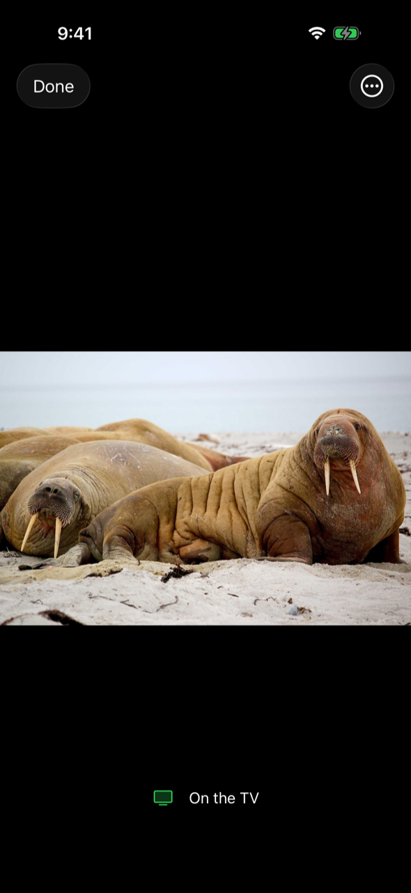 | 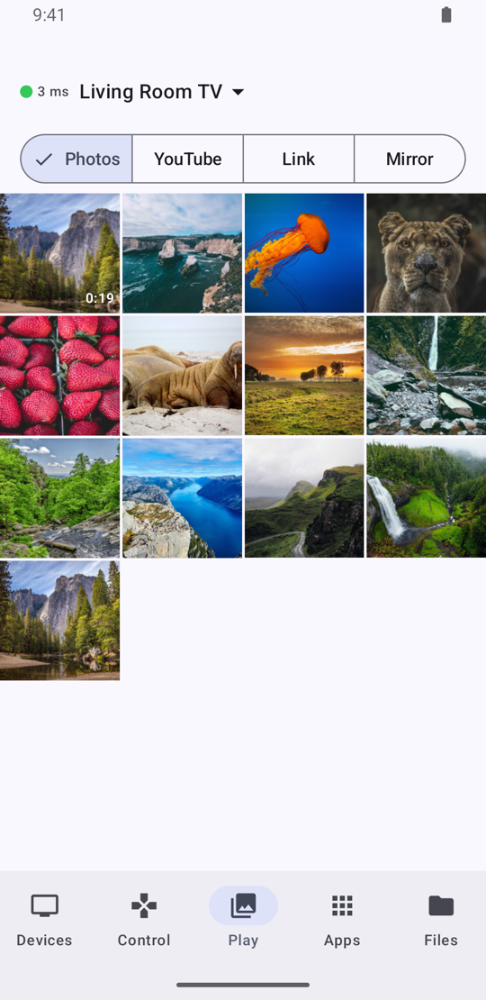  |

- **Open the viewer**: tap a photo or video. It appears on the TV (**On the TV**).
- **Change photo**: swipe left or right; the TV crossfades to the next one.
- **Zoom**: pinch or double-tap; the TV shows the same part of the picture.
- **Videos**:
  - They play on the TV straight away, streamed from the phone.
  - Use play/pause, ±10 seconds and the scrubber on the phone. They follow the TV's own
    remote too.

    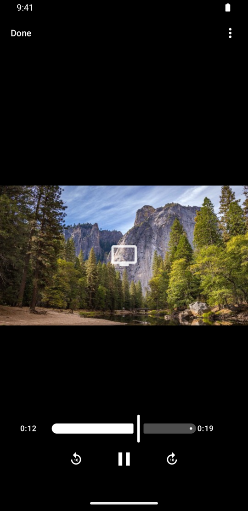 
- **The ⋯ menu**: **Show on TV Automatically** (turn it off to prepare a photo first, then
  tap **Show**) and **Clear the TV Screen**.
- **Done** closes the viewer on the TV, and the TV returns to what it was showing.

The TV app ("Photos from iPhone") is installed on the TV automatically the first time.

### YouTube and links

| iPhone | Android |
| --- | --- |
| 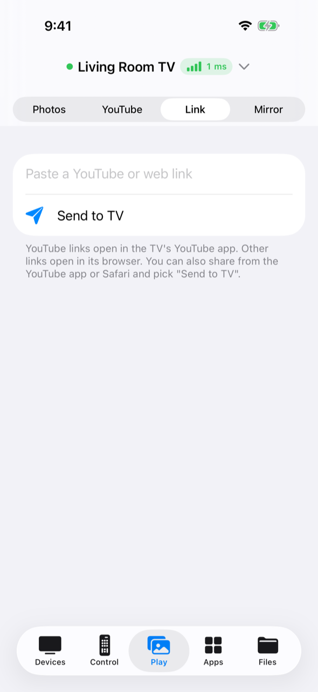 | 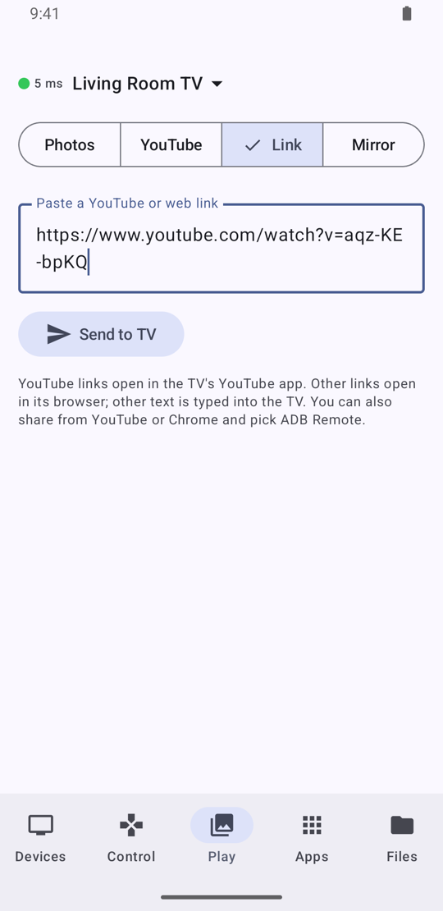 |

- **YouTube**: browse youtube.com in the app. On a video, tap **Play on TV** and it opens in
  the TV's YouTube app. The app looks for YouTube, SmartTube and TizenTube, in that order.
- **Link**: paste a link and tap **Send to TV**.
  - YouTube links open in the YouTube app; other links open in the TV's browser.
  - Plain text is typed on the TV.
- **Share sheet**: in YouTube, Safari, Chrome or any app, share a link and choose **Send to
  TV** (iPhone) or **ADB Remote** (Android).

### Mirror

**iPhone (AirPlay)**

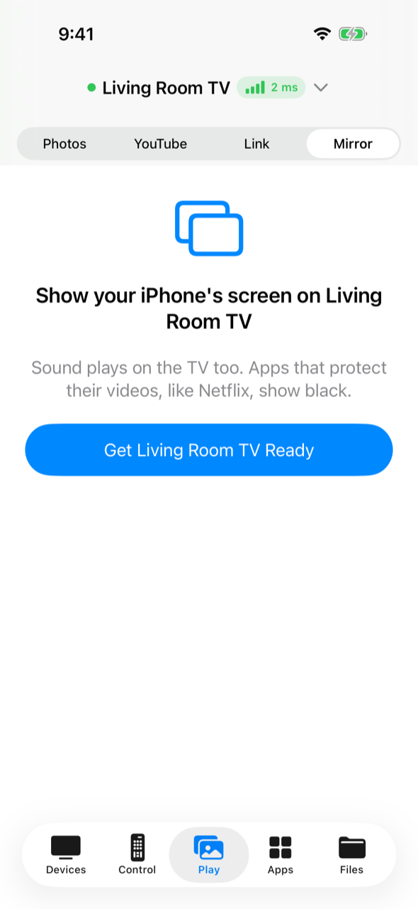

1. Tap **Get <TV> Ready**. This starts an AirPlay receiver in the TV app.
2. Open Control Center → **Screen Mirroring** → choose the TV.

What it covers:
- Your screen and sound appear on the TV.
- The Music app and other audio apps can play to the TV over AirPlay.
- YouTube and Photos videos sent with AirPlay play directly on the TV.

To stop, use **Stop Mirroring** on the iPhone, or **Back** on the TV remote. The receiver
switches itself off after 10 minutes without use.

**Android**

| Phone | TV |
| --- | --- |
| 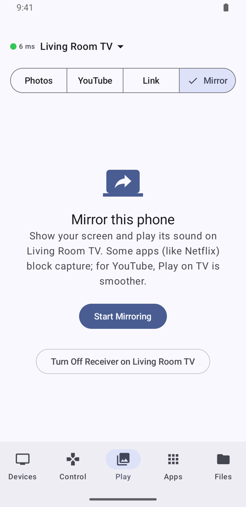 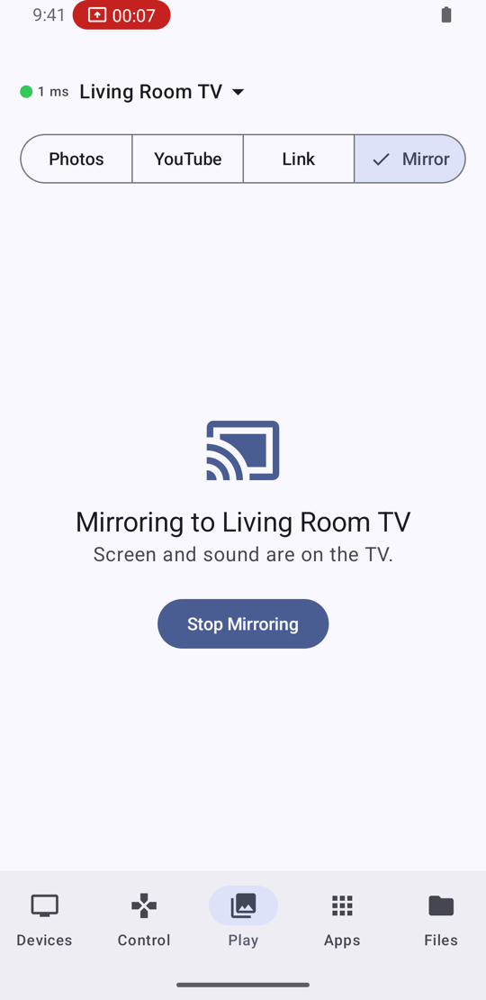 |  |

1. Tap **Start Mirroring**.
2. Allow screen capture: choose **Share entire screen**.
3. Allow the microphone permission. Android needs it to capture the sound apps play; the
   microphone itself isn't used.

What it covers:
- The screen and sound go to the TV.
- Rotating the phone turns the picture on the TV.

To stop, tap **Stop Mirroring**, use the notification's **Stop**, or press **Back** on the TV
remote.

## Apps

| iPhone | Android |
| --- | --- |
|  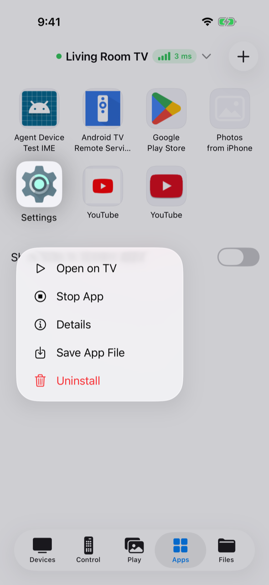 |  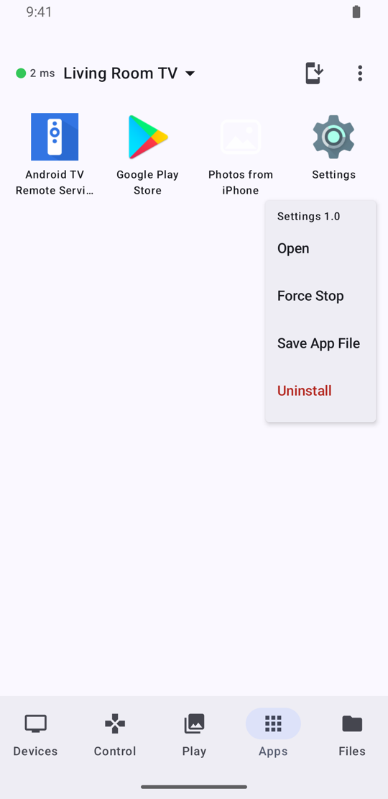 |

- **Tap** an app to open it on the TV.
- **Long-press** an app for more: **Open**, **Force Stop**, **Save App File** and
  **Uninstall**.
  - Saving gives you the app's APK, or `.apks` for apps split into parts.
  - Built-in apps can be uninstalled for the current user. A factory reset brings them back.
- **Install** (the button at the top): pick an `.apk`, `.apks`, `.xapk` or `.apkm` file.
- **Search, system apps, refresh**:
  - Android: **Search**, **Show System Apps** and **Refresh** are in the ⋮ menu.
  - iPhone: pull down to refresh; the switch at the bottom shows built-in apps.

## Files

| iPhone | Android |
| --- | --- |
| 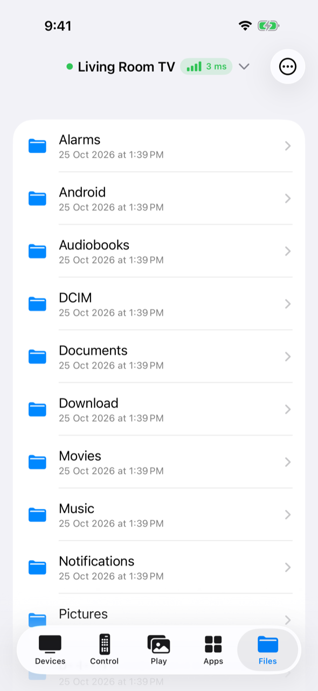 | 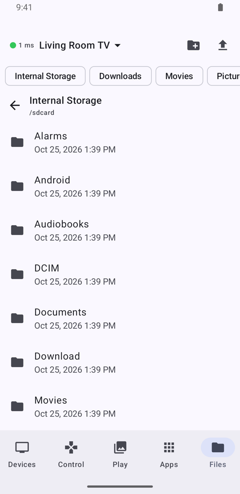 |

- **Shortcuts**: Internal Storage, Downloads, Movies, Pictures, USB drives / SD cards, and
  the whole file system. They're chips at the top on Android, and under ⋯ → **Go To** on
  iPhone.
- **Folders**: tap one to open it.
- **Files**: tap one to **save it to the phone**, **open it on the TV**, **rename** or
  **delete** it.
  - On iPhone you can also swipe a row to rename or delete.
  - On Android, long-press works on folders too.
- **Upload** files from the phone, and create **new folders**: buttons at the top on
  Android, ⋯ menu on iPhone.

## Troubleshooting

- **"Connection refused" or nothing found**: debugging is off on the TV, or it uses
  another port. Leave the port blank and choose **Scan for ADB port**.
- **Connects but every command fails**: some devices (BlueStacks, for example) keep the
  connection but refuse commands once debugging is switched off. Turn it back on and tap
  **Retry**.
- **"TLS error" / needs pairing**: the device uses Wireless debugging. Use **Pair with Code**.
- **The remote feels slow**: share the connection log from the device's menu. It shows how
  long each key press took.
- **A video won't play on the TV**: older TVs can't decode HEVC or 4K. On iPhone such videos
  are converted automatically.
